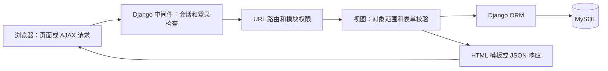
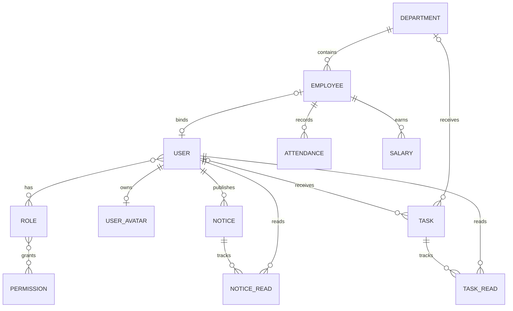

# 企业员工管理系统（HRMS）

基于 Django 和 MySQL 的 Web 课程设计项目。系统以部门、员工档案和登录账号为基础，提供考勤、薪资、公告、任务派发和统计功能。不同角色使用同一套系统，但能打开的模块和能查看的数据不同。设计的重点是把登录身份、人事档案和业务记录分开：登记员工不等于授予登录权限，授权查看薪资也不等于可以查看所有人的薪资。

> **版本说明：** 本仓库发布 2026 年 11 月 6 日 15:02 的无 AI 课程交付版，包含源码、迁移、测试和课程材料。功能和数据结构沿用原交付包 `HRMS_交付包_20261106_150244.zip`；公开版不附带本机 MySQL 数据、上传文件，且不在配置中预填数据库口令。

- [课程任务书对照](#课程任务书对照)
- [本地运行](#本地运行)
- [教师验收与答辩演示](#教师验收与答辩演示)
- [系统设计与代码索引](#系统设计与代码索引)
- [角色权限与数据隔离](#角色权限与数据隔离)
- [页面路由与接口示例](#页面路由与接口示例)
- [数据库初始化与维护](#数据库初始化与维护)
- [测试与验证记录](#测试与验证记录)
- [常见问题与交付边界](#常见问题与交付边界)

## 课程任务书对照

T1–T9 为必做项，T10–T13 为选做项。表中给出每项在交付版中的实现和便于核查的入口；功能已实现不等于已完成生产部署。

| 编号 | 要求 | 实现及核查入口 |
| --- | --- | --- |
| T1 | Django、MySQL、自定义用户 | `requirements.txt` 固定依赖版本；`DjangoProject1/settings.py` 配置 `app01.User` 和 MySQL；`app01/migrations/` 保存版本化表结构。 |
| T2 | 部门管理 | `/depart/list/` 提供列表和维护入口；`app01/views/depart.py` 处理新增、编辑和删除。已有受保护关联的部门不能直接删掉。 |
| T3 | 员工档案 | `/user/list/` 支持姓名查询、部门及职位筛选、领导岗位优先排序和分页。新增员工可选择是否同时开通普通员工账号；头像通过独立入口维护。 |
| T4 | 登录、验证码与会话 | `/login/` 校验图片验证码和账号密码；Django 会话保存登录状态；`app01/middleware/auth.py` 拦截未登录访问。 |
| T5 | 用户、角色、权限 | `/admin/list/` 管理业务登录账号，`/role/list/` 管理角色。权限中间件检查接口操作，模板标签控制菜单和按钮，视图再检查数据范围。 |
| T6 | 考勤管理 | `/attendance/list/` 支持员工、日期查询和记录维护；`Attendance.compute_status()` 根据上下班时间计算状态。 |
| T7 | 薪资管理 | `/salary/list/` 支持按员工和月份筛选；记录保存时计算实发金额，页面用 ORM 汇总筛选结果。 |
| T8 | 公告管理 | `/notice/list/` 支持发布、编辑、置顶、搜索和分页；置顶优先，其次按发布时间倒序排列。 |
| T9 | AJAX 任务 | `/task/list/` 可派发给个人或部门组；`POST /task/ajax/add/` 返回 JSON，表单错误原地显示，不刷新页面。 |
| T10 | 数据可视化 | `/chart/` 用 ECharts 展示部门人数、成员明细和月度实发工资趋势；接口按当前用户的数据范围统计。 |
| T11 | 关联查询优化 | `select_related` 用于员工所属部门、薪资关联员工、公告发布人等外键关系；多对多权限支持预取。`app01/test_requirement_coverage.py` 检查公告发布人姓名回退时的查询数。 |
| T12 | 自动化测试 | `app01/tests.py` 及 `app01/test_*.py` 检查权限、业务规则、初始化等；前端另有员工开户和自动筛选脚本测试。 |
| T13 | 配置、安全响应与日志 | 支持从环境变量开启开发模式和设置主机白名单；关闭 DEBUG 时启用 HTTPS 相关配置。控制台记录 INFO，滚动文件记录 WARNING 及以上。 |

## 本地运行

### 1. 准备环境和源码

| 项目 | 版本或用途 |
| --- | --- |
| Python | 推荐 Python 3.12 x64；下文以 Windows PowerShell 为例。 |
| 数据库 | 推荐 MySQL 8.0；课程交付记录使用 MySQL 8.0.45。请先启动服务。 |
| Python 依赖 | `Django==5.2.17`、`mysqlclient==2.3.0`、`Pillow==11.3.0`，以源码包的 `requirements.txt` 为准。 |
| 前端 | Django 模板、Bootstrap 3.4.1、jQuery 3.6.0、ECharts。运行网页不需要 npm 构建；Node.js 只用于运行 JavaScript 测试。 |

克隆本仓库，或在 GitHub 点击 **Code → Download ZIP** 后解压。以下命令均在包含 `manage.py` 和 `init_database.py` 的项目根目录运行。

```powershell
git clone https://github.com/A1Chao/HRMS.git
Set-Location HRMS
```

使用本机专用试验库，避免连接正在使用的 HRMS 数据库；本版的数据库名固定为 `ems_hrms`。用于初始化的 MySQL 用户需要对该库具备建表、迁移和读写权限；如果数据库还不存在，也需要有权创建它，或请管理员先创建 `utf8mb4` 库。

### 2. 安装依赖并配置本机连接

```powershell
py -3.12 -m venv .venv-hrms
$python = (Resolve-Path .\.venv-hrms\Scripts\python.exe).Path
& $python -m pip install -r requirements.txt
```

没有 `py` 启动器时，用本机 Python 3.12 的完整路径替代第一行中的 `py -3.12`。以下变量仅对当前终端及从中启动的进程生效；项目不会自动读取 `.env`。

```powershell
$env:DJANGO_DEBUG = '1'
$env:DJANGO_ALLOWED_HOSTS = '127.0.0.1,localhost'
$env:DJANGO_DB_HOST = '127.0.0.1'
$env:DJANGO_DB_PORT = '3306'
$env:DJANGO_DB_USER = Read-Host '本机 MySQL 用户名'
$dbPassword = Read-Host '本机 MySQL 密码' -AsSecureString
$env:DJANGO_DB_PASSWORD = [System.Net.NetworkCredential]::new('', $dbPassword).Password
Remove-Variable dbPassword
```

此处输入的是 **MySQL 连接凭据**，不是网页登录账号。演示账号与初始密码见[交付与数据库初始化](docs/交付与数据库初始化.md)，仅限本机课堂演示。

### 3. 初始化数据库并启动

```powershell
& $python init_database.py --with-demo --with-demo-managers
if ($LASTEXITCODE -ne 0) { throw '初始化失败，请先查看并处理上方报错。' }
& $python manage.py check
if ($LASTEXITCODE -ne 0) { throw 'Django 配置检查未通过。' }
& $python manage.py runserver 127.0.0.1:8000
```

启动后打开 [http://127.0.0.1:8000/](http://127.0.0.1:8000/)。需要不同数据规模时，**选择一种**初始化方式：

| 命令 | 首次在空库执行的结果 |
| --- | --- |
| `python init_database.py` | 创建或连接目标库，应用既有迁移并核对表结构，不创建业务账号。 |
| `python init_database.py --with-demo` | 另加入 8 名员工、3 个登录账号、24 条演示薪资。 |
| `python init_database.py --with-demo --with-demo-managers` | 完整答辩数据：11 名员工、6 个登录账号、33 条演示薪资。 |

初始化脚本沿用 Django 迁移，不需要为初次安装重新执行 `makemigrations`。脚本不清库、不修改已有账号密码，也不会把源码作者的业务数据复制到本机。

## 教师验收与答辩演示

建议在空库完成完整演示初始化后，按下面的顺序验收。修改类操作仅使用临时演示记录。

| 顺序 | 操作 | 预期结果 |
| --- | --- | --- |
| 1. 登录 | 未登录时访问 `/user/list/`，再用错误验证码提交登录。 | 未登录访问跳转登录页；验证码错误不建立登录会话。 |
| 2. 员工和账号 | 以演示超级管理员登录，按部门和职位筛选。新增一名临时员工，取消“同时开通登录账号”；再用另一条临时员工记录演示开户校验。 | 不开户时只有员工档案；有开户权限时可以创建普通员工账号；登录名重复时提示冲突，不覆盖原账号。 |
| 3. 部门数据范围 | 分别用部门管理员、普通员工查看员工、考勤和薪资列表。 | 部门管理员看到负责部门；普通员工在这三个模块只看到本人记录，且无编辑权限。 |
| 4. 考勤与薪资 | 为临时员工录入入职日后的考勤（09:15 上班、18:00 下班）。再录入基本工资 8000、奖金 500、扣款 200。 | 考勤显示“迟到”，实发工资为 8300.00；同一员工重复录入同日考勤或同月薪资会被拦截。 |
| 5. 公告与任务 | 发布两条演示公告并置顶较早一条。新增任务时不提交必填标题，再选定个人或部门、补齐内容重新提交。 | 置顶公告优先；任务错误在原页面显示，保存成功后列表更新。任务接收人可切换完成状态。 |
| 6. 图表核对 | 完成临时数据演示前，或在未改动的演示库中，以超级管理员进入 `/chart/`。薪资列表选择 `2025-01` 至 `2025-03` 之间的月份。 | 初始部门人数为技术部 4 人、市场部 4 人、人力资源部 3 人，合计 11 人。人数按员工档案而不是账号统计，演示薪资落在指定月份。 |

### 建议补测的边界

| 编号 | 验收动作 | 应观察到的结果 |
| --- | --- | --- |
| A01 | 验证码取图后等待超过 60 秒再登录；或提交一次后用同一验证码再次提交。 | 过期或已用过的验证码不能建立会话；刷新验证码后才可重试。 |
| A02 | 使用普通员工账号直接打开 `/user/add/`，而不只检查按钮是否隐藏。 | 返回权限不足（HTTP 403），不进入新增员工流程。 |
| A03 | 部门管理员在员工列表提交其他部门的合法 `department_id`，并单独打开图表页。 | 筛选不返回其他部门员工；图表的部门统计和成员明细仍只覆盖负责部门。 |
| A04 | 提交不存在的考勤筛选日期 `2025-02-30`；再尝试录入早于员工入职日的考勤。 | 不合法的查询返回 HTTP 400；不符合业务规则的新增不落库。 |
| A05 | 在任务新增表单中缺少负责人，或同时提交个人与部门组。 | 返回 `status: false` 和对应字段错误，不生成任务。 |
| A06 | 给有受保护记录的临时员工尝试删除，再查看原考勤或工资。 | 删除被拦截，原业务数据仍在。 |

答辩时可以用“新增员工但不开账号”“部门管理员看不到其他部门工资”“任务错误原地回显”这三个例子串起数据建模、后端鉴权和前端交互。

## 系统设计与代码索引

### 请求处理



以员工列表为例：`DjangoProject1/urls.py` 将 `/user/list/` 交给 `app01/views/user.py`。视图先用 `request.user.scope_employees()` 限定可见员工，再加姓名、部门、职位筛选，最后排序、分页并渲染 `templates/user_list.html`。这保证了搜索条件只能缩小可见范围，不能扩大权限。图表接口也复用这个范围，再做 `Count` 或 `Sum` 聚合。

### 核心数据关系与业务规则

下图只画验收涉及的主要关系；用户与角色、角色与权限的多对多关系由 Django 的中间表保存。`Task` 的两条派发关系是可选外键，**创建时恰好选一个**，不是一条任务同时绑定两种目标。



| 模型或关系 | 设计与约束 |
| --- | --- |
| `Department` → `Employee` | 一个部门对应多名员工，部门名称唯一；员工归属部门是人事统计的基础。 |
| `Employee` ↔ `User` | 可空的一对一关系。员工档案可以没有登录账号，独立系统管理员也可以不关联员工。已关联员工的登录密码由 Django 哈希保存，不存明文。 |
| `User` ↔ `Role` ↔ `Permission` | 两段多对多关系。管理员可维护角色，实际访问由权限编码与对象范围共同决定，不按角色显示名简单判断。 |
| `Employee` → `Attendance` | 每名员工每天最多一条。缺任一打卡时间判缺勤；否则先判断晚于 09:00 的迟到，再判断早于 18:00 的早退，剩余为按时。下班须晚于上班，考勤不能早于入职日期。 |
| `Employee` → `Salary` | 每名员工每月最多一条。实发 = 基本工资 + 奖金 − 扣款，按两位小数保存；薪资月份不能早于入职月份。 |
| `Notice`、`Task` 与阅读记录 | `NoticeRead`、`TaskRead` 按用户记录已读。任务只能选择个人负责人或部门组其中之一，并可记录完成人和完成时间。 |
| `User` ↔ `UserAvatar` | 头像关联登录账号。上传内容经 Pillow 检查和处理后保存为 PNG 数据，读取也检查访问范围。 |

**关键字段如何落库：** `Employee.mobile` 是员工档案的唯一手机号；`User.employee_id` 对应可空的一对一关联；`User.managed_department_id` 单独记录账号负责部门。`Attendance(employee_id, date)`、`Salary(employee_id, month)` 分别构成组合唯一约束；公告和任务的已读记录则按“对象 ID + 用户 ID”去重。考勤状态、实发金额由模型计算，不由浏览器直接提交。

**录入员工与开户同成同败。** 员工档案本身允许出现实际同名人员；开通账号时才检查登录名和注册姓名是否重复。具备开户权限的操作者可在员工录入页开通普通员工账号，开户和档案写入放在同一事务中。如果开户失败，档案也不会半途保存。

### 源码目录

```text
HRMS/
├── manage.py                          # Django 管理命令入口
├── init_database.py                   # 建库、迁移和可选演示数据入口
├── requirements.txt                  # Python 依赖
├── DjangoProject1/
│   ├── settings.py                    # 数据库、权限中间件、日志和环境配置
│   └── urls.py                        # 页面和接口路由
├── app01/
│   ├── models.py                      # 人事、权限与业务模型
│   ├── views/                         # 按模块拆分的请求处理
│   ├── middleware/                    # 登录、模块权限与头像上传相关处理
│   ├── utils/                         # 表单、分页、开户和数据校验
│   ├── templatetags/                  # 权限与头像模板标签
│   ├── migrations/                    # 数据库迁移
│   ├── management/commands/           # 演示初始化、数据审计等管理命令
│   ├── static/                        # 前端插件和交互脚本
│   └── tests.py / test_*.py / test_*.js # 后端及前端测试
├── templates/                         # 布局、列表、表单和统计页面
└── docs/                              # 课程任务书、初始化说明和验收记录
```

业务账号管理在 `/admin/list/`；Django 自带后台是 `/admin/`，两者不是同一个页面。要核查表单限制，先看 `app01/utils/form.py`；要核查对象范围，先看 `app01/models.py` 的 `User.scope_employees()` 和对应 `views/` 文件。

## 角色权限与数据隔离

以下是演示初始化的默认角色，不是按账号名写死的菜单。角色的权限清单由 `app01/management/commands/init_data.py` 初始化，业务权限映射位于 `app01/middleware/permission.py`。

| 业务 | 超级管理员 | 部门管理员 | 普通员工 |
| --- | --- | --- | --- |
| 部门 | 查看、维护 | 查看 | 无默认权限 |
| 员工档案 | 全部；可维护和按权限开户 | 查看、维护负责部门员工；默认不能开通登录账号 | 查看本人 |
| 考勤和薪资 | 全部；可维护 | 查看、维护负责部门记录 | 查看本人 |
| 公告 | 查看、维护 | 可查看和维护，写入操作还受视图规则约束 | 无默认权限 |
| 任务 | 查看、派发、维护 | 按派发与管理范围操作 | 查看、处理发给本人或所属部门的任务；不能派发 |
| 图表 | 全公司 | 负责部门 | 无默认权限 |
| 业务账号与角色 | 管理 | 无默认权限 | 无默认权限 |

一次访问通常经过三层检查：

1. **身份认证**：Django 根据会话还原 `request.user`；`app01/middleware/auth.py` 对未登录业务请求返回登录跳转。验证码仅保存在会话中，有效期 60 秒，提交后即失效；登录成功后的 `next` 只接受站内路径。
2. **模块和动作**：浏览 `/salary/list/` 要有 `salary.view`，编辑 `/salary/<int:nid>/edit/` 要有 `salary.edit`。权限中间件先匹配写操作，再匹配模块的通用规则；模板上的“编辑”按钮只负责展示，不能代替后端校验。
3. **对象范围**：薪资视图仍须限定 `employee__in=request.user.scope_employees()`。即使一个账号拥有 `salary.edit`，它也不能据此修改范围外员工的薪资。任务完成状态另外检查操作者是否为接收人或有权维护该任务；不能把“谁收到任务”和“谁管理部门”当成同一件事。

新增业务路由时不能只写视图和模板：当前权限中间件对**未匹配的路径默认放行**，需同步补上路由权限、对象范围检查和反例测试。批量写入也不能直接绕过 `ModelForm` 与模型校验；例如 `QuerySet.update()` 不会调用模型的 `save()`，不适合拿来修改需要重算的薪资或打卡来源字段。

## 页面路由与接口示例

下表是课堂验收常用入口。它们是同源网页登录后的页面与 AJAX 接口，不是面向第三方的开放 API。`POST` 需要带该会话的 CSRF token。没有登录通常先跳转到登录页，而不是返回业务 JSON。

| 请求 | 字段与作用 | 可读源码 |
| --- | --- | --- |
| `GET /user/list/` | `q`（姓名）、`department_id`、`position`、`page`；先按账号范围过滤，再搜索、排序和分页。 | `app01/views/user.py` |
| `GET /attendance/list/` | `q`（员工姓名）、`date`（`YYYY-MM-DD`）；非法日期返回 HTTP 400。 | `app01/views/attendance.py` |
| `GET /salary/list/` | `q`（员工姓名）、`month`（`YYYY-MM`）；筛选结果的工资合计按整个结果集查询，不按当前一页求和。 | `app01/views/salary.py` |
| `GET /notice/list/` | `q` 按公告标题搜索，结果按置顶与发布时间排序。 | `app01/views/notice.py` |
| `POST /task/ajax/add/` | 提交 `title`、`detail`、`level`、`target_type`；个人用 `assignee`，部门组用 `assignee_department`，不能同时填。 | `app01/views/task.py`、`app01/utils/form.py` |
| `POST /task/<int:nid>/status/` | `completed=1` 标记已完成，`completed=0` 恢复未完成；成功后返回任务列表。 | `app01/views/task.py` |
| `GET /chart/depart/data/` | 返回 `data`（部门人数）、`total`（总人数）、`members`（部门成员明细）。 | `app01/views/chart.py` |
| `GET /chart/salary/data/` | `data.months` 和 `data.totals` 一一对应；按月累计可见员工的实发金额。 | `app01/views/chart.py` |

**任务校验失败示例。** 在有派发权限的已登录会话中，填写标题、详情和任务级别，选择 `target_type=department`，但不选部门。服务端返回：

```json
{
  "status": false,
  "errors": {
    "assignee_department": ["请选择负责人组（部门）", "个人负责人和部门组必须且只能选择一个"],
    "assignee": ["个人负责人和部门组必须且只能选择一个"]
  }
}
```

表单校验失败的 JSON 要看 `status` 和 `errors`，不能只看 HTTP 状态码。成功时 `status` 为 `true`，`data` 中包含任务 ID、级别展示文本、标题、详情、派发目标、目标类型、创建时间和完成状态；前端更新列表而不把失败的输入丢掉。使用浏览器开发者工具的 **Network** 标签，即可在课堂演示中核对请求与响应。

**两个统计口径。** 部门接口对可见员工档案按部门 `Count`，即使员工没有账号也计入人数；薪资接口对相同员工范围内的薪资记录按 `month` 把 `total` 做 `Sum`，不是取工资平均值，也不会为没有记录的月份补造数据。列表和图表使用同一套数据范围，但列表按筛选项展示记录，图表按整个可见范围聚合。

## 数据库初始化与维护

`init_database.py` 读取和应用本身相同的 MySQL 配置。脚本检查设置和迁移状态、应用已有迁移，并核对模型要求的表与列。它不替代备份，也不会把没有迁移历史的旧表强行标记为已迁移。

| 迁移 | 主要用途 |
| --- | --- |
| `0001_initial.py` | 建立初始系统模型。 |
| `0002_user_employee_user_managed_department.py` | 为账号增加已绑定员工及负责部门的关系。 |
| `0003`–`0005` | 增加任务完成状态、普通员工任务查看权限及部门组派发相关结构。 |
| `0006_employee_position.py`、`0007_employee_is_demo.py` | 新增员工职位和演示数据标记。 |
| `0008_useravatar.py` | 增加与账号一对一的数据库头像模型。 |

需要检查演示库时，优先使用这些只读命令：

```powershell
& $python manage.py showmigrations app01
& $python manage.py audit_hrms_data --json
& $python manage.py fill_demo_salaries --json
```

第一条列出迁移应用状态；第二条读取并检查表结构、外键、账号档案关系及业务日期；第三条只预演补齐演示薪资。后者只有显式传入 `--apply --allow-demo` 才会写入，只处理 `is_demo=True` 的员工，不覆盖已有工资。审计输出可能包含业务记录标识，不要直接上传。初始化或迁移报错时先确认环境变量和库状态，不要使用 `--fake` 或直接删表来跳过报错。

## 测试与验证记录

在项目根目录、已配置本机虚拟环境及 MySQL 连接的终端运行：

```powershell
& $python manage.py check
& $python manage.py test app01.test_database_bootstrap
& $python manage.py test app01 --verbosity 2
node app01/test_list_filters.js
node app01/test_employee_onboarding.js
```

### 回归测试索引

| 关注点 | 入口 | 主要检查内容 |
| --- | --- | --- |
| 初始化流程 | `app01/test_database_bootstrap.py` | 用模拟连接检查建库配置、连接流程、迁移和表结构；不要求启动实际 MySQL。 |
| 入职和账号 | `app01/test_employee_onboarding.py`、`app01/test_registration_uniqueness.py` | 档案与账号同时保存或回滚、开户授权、登录名与注册姓名重复限制。 |
| 权限与数据校验 | `app01/test_security_fixes.py` | 权限委派、无效日期、分页、考勤与薪资派生值等反例。 |
| 头像 | `app01/test_avatars.py` | 图片规范化、本人及部门权限、非法上传处理。 |
| 统计和查询 | `app01/test_chart_demo_salaries.py`、`app01/test_requirement_coverage.py` | 演示薪资和图表结果、公告发布人关联查询。 |
| 前端交互 | `app01/test_employee_onboarding.js`、`app01/test_list_filters.js` | 员工可选开户控件、列表自动筛选和分页参数。 |

### 验证结果
- 全量 Django 回归需要 MySQL 和创建、删除测试库的权限。请使用专门的测试实例，不在业务服务器上执行。
- 2026 年 11 月 6 日源码包内的 `docs/功能验收与自测记录.md` 记载：隔离 MySQL 测试库中 **359 项后端测试通过**，另有 **14 个 JavaScript 场景通过**。这不是 GitHub CI 结果。
- 公开版发布前，在本仓库代码上重新验证了 `manage.py check`、**22 项数据库初始化单元测试**及上述 **14 个 JavaScript 场景**；没有重新执行完整 MySQL 回归或逐页浏览器验收。

课程材料：[企业员工管理系统课程设计任务书](docs/企业员工管理系统课程设计任务书.md) · [交付与数据库初始化](docs/交付与数据库初始化.md) · [功能验收与自测记录](docs/功能验收与自测记录.md)。验收记录是 11 月 6 日打包时的记录，其中对 Git 状态的描述不代表当前仓库。

## 常见问题与交付边界

| 现象 | 排查方式 |
| --- | --- |
| `manage.py` 不存在 | 确认已克隆仓库或完整解压 GitHub 下载的 ZIP，并进入实际包含 `manage.py` 的目录。 |
| `Unknown database 'ems_hrms'` | 先确认 MySQL 服务和当前连接，再运行 `init_database.py`；普通 `migrate` 不负责创建数据库。 |
| `Access denied` | 检查 MySQL 用户、口令、端口和授权范围，不要填网页账号来连接 MySQL。 |
| 图表或薪资筛选没有数据 | 核对初始化选项、账号的数据范围和所选月份；演示工资固定在 2025 年 1–3 月。 |
| 员工已录入但无法登录 | 检查是否开通并明确关联了 `User`；`Employee` 档案本身不能用于登录。 |
| 删除部门或员工被阻止 | 检查其下的员工、登录账号、考勤、薪资或任务等受保护关联，不要直接删库绕过约束。 |
| 页面跳转 HTTPS 或报主机错误 | 本地使用 `DJANGO_DEBUG=1`、本机地址和正确的 `DJANGO_ALLOWED_HOSTS`；生产配置不能照搬本地示例。 |

该版本面向课程演示，不把 `runserver`、演示账号或源码包当作生产部署方案。部署到公网前需关闭 DEBUG，配置稳定的 `DJANGO_SECRET_KEY`、明确的 `DJANGO_ALLOWED_HOSTS`、专用数据库凭据以及 HTTPS，并重新审查部署安全。不要把数据库转储、真实员工资料、头像、运行日志或环境密钥提交到 GitHub。
