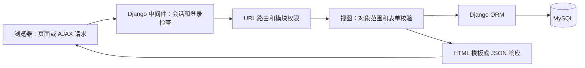

# 企业员工管理系统（HRMS）

基于 Django 和 MySQL 的 Web 课程设计项目。系统以部门、员工档案和登录账号为基础，提供考勤、薪资、公告、任务派发和统计功能。不同角色使用同一套系统，但能打开的模块和能查看的数据不同。

> **版本与取件说明：** 本文对应 2026 年 11 月 6 日 15:02 的无 AI 课程交付版。当前 GitHub 仓库仅发布 README；运行、答辩和代码验收请使用同版本源码包 `HRMS_交付包_20261106_150244.zip`。下文的文件路径均相对于解压后的项目根目录，不能用只含本文的 GitHub 仓库直接启动。源码包自带迁移、测试和课程材料，不含作者的 MySQL 数据或上传文件。

- [课程任务书对照](#课程任务书对照)
- [本地运行](#本地运行)
- [教师验收与答辩演示](#教师验收与答辩演示)
- [系统设计与代码索引](#系统设计与代码索引)
- [测试与验证记录](#测试与验证记录)
- [常见问题与交付边界](#常见问题与交付边界)

## 课程任务书对照

T1–T9 为必做项，T10–T13 为选做项。表中给出每项在交付版中的实现和便于核查的入口；功能已实现不等于已完成生产部署。

| 编号 | 要求 | 实现及核查入口 |
| --- | --- | --- |
| T1 | Django、MySQL、自定义用户 | `requirements.txt` 固定依赖版本；`DjangoProject1/settings.py` 配置 `app01.User` 和 MySQL；`app01/migrations/` 保存版本化表结构。 |
| T2 | 部门管理 | `/depart/list/` 提供列表和维护入口；`app01/views/depart.py` 处理新增、编辑和删除。已有受保护关联的部门不能直接删掉。 |
| T3 | 员工档案 | `/user/list/` 支持姓名查询、部门及职位筛选、领导岗位优先排序和分页。新增员工可选择是否同时开通普通员工账号；头像通过独立入口维护。 |
| T4 | 登录、验证码与会话 | `/login/` 校验图片验证码和账号密码；Django 会话保存登录状态；`app01/middleware/auth.py` 拦截未登录访问。 |
| T5 | 用户、角色、权限 | `/admin/list/` 管理业务登录账号，`/role/list/` 管理角色。权限中间件检查接口操作，模板标签控制菜单和按钮，视图再检查数据范围。 |
| T6 | 考勤管理 | `/attendance/list/` 支持员工、日期查询和记录维护；`Attendance.compute_status()` 根据上下班时间计算状态。 |
| T7 | 薪资管理 | `/salary/list/` 支持按员工和月份筛选；记录保存时计算实发金额，页面用 ORM 汇总筛选结果。 |
| T8 | 公告管理 | `/notice/list/` 支持发布、编辑、置顶、搜索和分页；置顶优先，其次按发布时间倒序排列。 |
| T9 | AJAX 任务 | `/task/list/` 可派发给个人或部门组；`POST /task/ajax/add/` 返回 JSON，表单错误原地显示，不刷新页面。 |
| T10 | 数据可视化 | `/chart/` 用 ECharts 展示部门人数、成员明细和月度实发工资趋势；接口按当前用户的数据范围统计。 |
| T11 | 关联查询优化 | `select_related` 用于员工所属部门、薪资关联员工、公告发布人等外键关系；多对多权限支持预取。`app01/test_requirement_coverage.py` 检查公告发布人姓名回退时的查询数。 |
| T12 | 自动化测试 | `app01/tests.py` 及 `app01/test_*.py` 检查权限、业务规则、初始化等；前端另有员工开户和自动筛选脚本测试。 |
| T13 | 配置、安全响应与日志 | 支持从环境变量开启开发模式和设置主机白名单；关闭 DEBUG 时启用 HTTPS 相关配置。控制台记录 INFO，滚动文件记录 WARNING 及以上。 |

## 本地运行

### 1. 准备环境和源码

| 项目 | 版本或用途 |
| --- | --- |
| Python | 推荐 Python 3.12 x64；下文以 Windows PowerShell 为例。 |
| 数据库 | 推荐 MySQL 8.0；课程交付记录使用 MySQL 8.0.45。请先启动服务。 |
| Python 依赖 | `Django==5.2.17`、`mysqlclient==2.3.0`、`Pillow==11.3.0`，以源码包的 `requirements.txt` 为准。 |
| 前端 | Django 模板、Bootstrap 3.4.1、jQuery 3.6.0、ECharts。运行网页不需要 npm 构建；Node.js 只用于运行 JavaScript 测试。 |

把同版本源码包解压到独立目录，进入与 `manage.py`、`init_database.py` 同级的目录。使用本机专用试验库，避免连接正在使用的 HRMS 数据库；本版的数据库名固定为 `ems_hrms`。用于初始化的 MySQL 用户需要对该库具备建表、迁移和读写权限；如果数据库还不存在，也需要有权创建它，或请管理员先创建 `utf8mb4` 库。

### 2. 安装依赖并配置本机连接

```powershell
py -3.12 -m venv .venv-hrms
$python = (Resolve-Path .\.venv-hrms\Scripts\python.exe).Path
& $python -m pip install -r requirements.txt
```

没有 `py` 启动器时，用本机 Python 3.12 的完整路径替代第一行中的 `py -3.12`。以下变量仅对当前终端及从中启动的进程生效；项目不会自动读取 `.env`。

```powershell
$env:DJANGO_DEBUG = '1'
$env:DJANGO_ALLOWED_HOSTS = '127.0.0.1,localhost'
$env:DJANGO_DB_HOST = '127.0.0.1'
$env:DJANGO_DB_PORT = '3306'
$env:DJANGO_DB_USER = Read-Host '本机 MySQL 用户名'
$dbPassword = Read-Host '本机 MySQL 密码' -AsSecureString
$env:DJANGO_DB_PASSWORD = [System.Net.NetworkCredential]::new('', $dbPassword).Password
Remove-Variable dbPassword
```

此处输入的是 **MySQL 连接凭据**，不是网页登录账号。演示密码按交付包内 `docs/交付与数据库初始化.md` 获取，仅限本机课堂演示。

### 3. 初始化数据库并启动

```powershell
& $python init_database.py --with-demo --with-demo-managers
if ($LASTEXITCODE -ne 0) { throw '初始化失败，请先查看并处理上方报错。' }
& $python manage.py check
if ($LASTEXITCODE -ne 0) { throw 'Django 配置检查未通过。' }
& $python manage.py runserver 127.0.0.1:8000
```

启动后打开 [http://127.0.0.1:8000/](http://127.0.0.1:8000/)。需要不同数据规模时，**选择一种**初始化方式：

| 命令 | 首次在空库执行的结果 |
| --- | --- |
| `python init_database.py` | 创建或连接目标库，应用既有迁移并核对表结构，不创建业务账号。 |
| `python init_database.py --with-demo` | 另加入 8 名员工、3 个登录账号、24 条演示薪资。 |
| `python init_database.py --with-demo --with-demo-managers` | 完整答辩数据：11 名员工、6 个登录账号、33 条演示薪资。 |

初始化脚本沿用 Django 迁移，不需要为初次安装重新执行 `makemigrations`。脚本不清库、不修改已有账号密码，也不会把源码作者的业务数据复制到本机。

## 教师验收与答辩演示

建议在空库完成完整演示初始化后，按下面的顺序验收。修改类操作仅使用临时演示记录。

| 顺序 | 操作 | 预期结果 |
| --- | --- | --- |
| 1. 登录 | 未登录时访问 `/user/list/`，再用错误验证码提交登录。 | 未登录访问跳转登录页；验证码错误不建立登录会话。 |
| 2. 员工和账号 | 以演示超级管理员登录，按部门和职位筛选。新增一名临时员工，取消“同时开通登录账号”；再用另一条临时员工记录演示开户校验。 | 不开户时只有员工档案；有开户权限时可以创建普通员工账号；登录名重复时提示冲突，不覆盖原账号。 |
| 3. 部门数据范围 | 分别用部门管理员、普通员工查看员工、考勤和薪资列表。 | 部门管理员看到负责部门；普通员工在这三个模块只看到本人记录，且无编辑权限。 |
| 4. 考勤与薪资 | 为临时员工录入入职日后的考勤（09:15 上班、18:00 下班）。再录入基本工资 8000、奖金 500、扣款 200。 | 考勤显示“迟到”，实发工资为 8300.00；同一员工重复录入同日考勤或同月薪资会被拦截。 |
| 5. 公告与任务 | 发布两条演示公告并置顶较早一条。新增任务时不提交必填标题，再选定个人或部门、补齐内容重新提交。 | 置顶公告优先；任务错误在原页面显示，保存成功后列表更新。任务接收人可切换完成状态。 |
| 6. 图表核对 | 完成临时数据演示前，或在未改动的演示库中，以超级管理员进入 `/chart/`。薪资列表选择 `2025-01` 至 `2025-03` 之间的月份。 | 初始部门人数为技术部 4 人、市场部 4 人、人力资源部 3 人，合计 11 人。人数按员工档案而不是账号统计，演示薪资落在指定月份。 |

**答辩可以重点讲三处：** `User` 与 `Employee` 为什么分开；角色权限为什么仍要配合部门或本人范围；同一份员工数据为什么在部门管理员和超级管理员的图表中统计不同。

## 系统设计与代码索引

### 请求处理



以员工列表为例：`DjangoProject1/urls.py` 将 `/user/list/` 交给 `app01/views/user.py`。视图先用 `request.user.scope_employees()` 限定可见员工，再加姓名、部门、职位筛选，最后排序、分页并渲染 `templates/user_list.html`。这保证了搜索条件只能缩小可见范围，不能扩大权限。图表接口也复用这个范围，再做 `Count` 或 `Sum` 聚合。

### 核心数据关系与业务规则

| 模型或关系 | 设计与约束 |
| --- | --- |
| `Department` → `Employee` | 一个部门对应多名员工，部门名称唯一；员工归属部门是人事统计的基础。 |
| `Employee` ↔ `User` | 可空的一对一关系。员工档案可以没有登录账号，独立系统管理员也可以不关联员工。已关联员工的登录密码由 Django 哈希保存，不存明文。 |
| `User` ↔ `Role` ↔ `Permission` | 两段多对多关系。管理员可维护角色，实际访问由权限编码与对象范围共同决定，不按角色显示名简单判断。 |
| `Employee` → `Attendance` | 每名员工每天最多一条。缺任一打卡时间判缺勤；否则先判断晚于 09:00 的迟到，再判断早于 18:00 的早退，剩余为按时。下班须晚于上班，考勤不能早于入职日期。 |
| `Employee` → `Salary` | 每名员工每月最多一条。实发 = 基本工资 + 奖金 − 扣款，按两位小数保存；薪资月份不能早于入职月份。 |
| `Notice`、`Task` 与阅读记录 | `NoticeRead`、`TaskRead` 按用户记录已读。任务只能选择个人负责人或部门组其中之一，并可记录完成人和完成时间。 |
| `User` ↔ `UserAvatar` | 头像关联登录账号。上传内容经 Pillow 检查和处理后保存为 PNG 数据，读取也检查访问范围。 |

**权限和数据范围分开检查。** RBAC 决定用户能否进入模块或执行编辑；对象范围决定用户能操作哪条记录。默认演示配置下，超级管理员全局可见，部门管理员只管理负责部门的员工相关记录，普通员工只读本人档案、考勤和薪资，并可处理发给本人或所属部门的任务。隐藏按钮只改善界面，不能替代后端校验。

**录入员工与开户同成同败。** 员工档案本身允许出现实际同名人员；开通账号时才检查登录名和注册姓名是否重复。具备开户权限的操作者可在员工录入页开通普通员工账号，开户和档案写入放在同一事务中。如果开户失败，档案也不会半途保存。

### 源码目录

```text
DjangoProject1_HRMS/
├── manage.py                          # Django 管理命令入口
├── init_database.py                   # 建库、迁移和可选演示数据入口
├── requirements.txt                  # Python 依赖
├── DjangoProject1/
│   ├── settings.py                    # 数据库、权限中间件、日志和环境配置
│   └── urls.py                        # 页面和接口路由
├── app01/
│   ├── models.py                      # 人事、权限与业务模型
│   ├── views/                         # 按模块拆分的请求处理
│   ├── middleware/                    # 登录、模块权限与头像上传相关处理
│   ├── utils/                         # 表单、分页、开户和数据校验
│   ├── templatetags/                  # 权限与头像模板标签
│   ├── migrations/                    # 数据库迁移
│   ├── management/commands/           # 演示初始化、数据审计等管理命令
│   ├── static/                        # 前端插件和交互脚本
│   └── tests.py / test_*.py / test_*.js # 后端及前端测试
├── templates/                         # 布局、列表、表单和统计页面
└── docs/                              # 课程任务书、初始化说明和验收记录
```

业务账号管理在 `/admin/list/`；Django 自带后台是 `/admin/`，两者不是同一个页面。要核查表单限制，先看 `app01/utils/form.py`；要核查对象范围，先看 `app01/models.py` 的 `User.scope_employees()` 和对应 `views/` 文件。

## 测试与验证记录

在解压后的源码目录、已配置本机虚拟环境及 MySQL 连接的终端运行：

```powershell
& $python manage.py check
& $python manage.py test app01.test_database_bootstrap
& $python manage.py test app01 --verbosity 2
node app01/test_list_filters.js
node app01/test_employee_onboarding.js
```

- `test_database_bootstrap` 使用模拟连接覆盖配置、建库流程和表结构检查，不要求启动实际 MySQL。
- 全量 Django 回归需要 MySQL 和创建、删除测试库的权限。请使用专门的测试实例，不在业务服务器上执行。
- 2026 年 11 月 6 日源码包内的 `docs/功能验收与自测记录.md` 记载：隔离 MySQL 测试库中 **359 项后端测试通过**，另有 **14 个 JavaScript 场景通过**。这不是 GitHub CI 结果。
- 本 README 发布前，从同一交付包重新验证了 `manage.py check`、**22 项数据库初始化单元测试**及上述 **14 个 JavaScript 场景**；没有重新执行完整 MySQL 回归或逐页浏览器验收。

课程材料均在源码包 `docs/` 中：`企业员工管理系统课程设计任务书.md`、`交付与数据库初始化.md`、`功能验收与自测记录.md`。

## 常见问题与交付边界

| 现象 | 排查方式 |
| --- | --- |
| `manage.py` 不存在 | 当前 GitHub 只有 README，或终端不在解压后的源码根目录。 |
| `Unknown database 'ems_hrms'` | 先确认 MySQL 服务和当前连接，再运行 `init_database.py`；普通 `migrate` 不负责创建数据库。 |
| `Access denied` | 检查 MySQL 用户、口令、端口和授权范围，不要填网页账号来连接 MySQL。 |
| 图表或薪资筛选没有数据 | 核对初始化选项、账号的数据范围和所选月份；演示工资固定在 2025 年 1–3 月。 |
| 员工已录入但无法登录 | 检查是否开通并明确关联了 `User`；`Employee` 档案本身不能用于登录。 |
| 删除部门或员工被阻止 | 检查其下的员工、登录账号、考勤、薪资或任务等受保护关联，不要直接删库绕过约束。 |
| 页面跳转 HTTPS 或报主机错误 | 本地使用 `DJANGO_DEBUG=1`、本机地址和正确的 `DJANGO_ALLOWED_HOSTS`；生产配置不能照搬本地示例。 |

该版本面向课程演示，不把 `runserver`、演示账号或源码包当作生产部署方案。部署到公网前需关闭 DEBUG，配置稳定的 `DJANGO_SECRET_KEY`、明确的 `DJANGO_ALLOWED_HOSTS`、专用数据库凭据以及 HTTPS，并重新审查部署安全。不要把数据库转储、真实员工资料、头像、运行日志或环境密钥提交到 GitHub。
